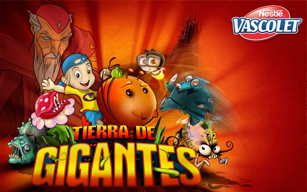
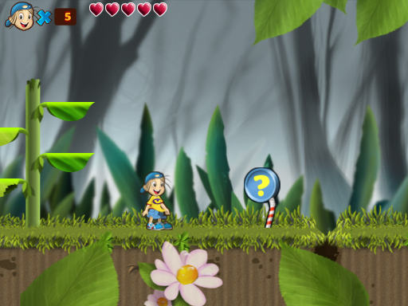
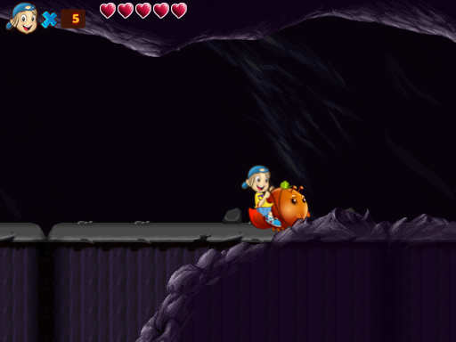

# Vascolet 4 — Tierra de Gigantes

  

Un homenaje hecho con cariño a **Vascolet 4**, el juego de plataformas uruguayo
de **Batoví Studio**. Para volver al boomerang, a Alejandro y a esos mundos enormes
que vale la pena conservar y compartir.

## [▶ Jugar en el navegador](https://frajusu.github.io/vascolet-4-web/)

Reconstruimos el juego en **JavaScript + Canvas**, usando sus mapas, personajes,
animaciones, música y sonidos originales. Sin instalaciones ni cuentas.

- **18 niveles**, con sus enemigos, jefes y recorridos especiales.
- Poderes, doble salto, carrera, natación, monturas y plataformas móviles.
- Objetos, logros y progreso guardado en tu navegador.

El proyecto sigue en desarrollo: seguimos afinando los detalles para acercarlo
cada vez más al original.

  
  

**Controles:** flechas para moverse · **Z/S** para saltar · **A/X** para lanzar
el boomerang · **Esc** para pausar.

---

Vascolet 4 y sus recursos pertenecen a sus autores originales. Este port web
**no oficial**, abierto y sin fines de lucro, es un proyecto de preservación y homenaje.

[Desarrollo](docs/startup-and-deployment.md) · [Estado de la campaña](docs/campaign-status.md)
